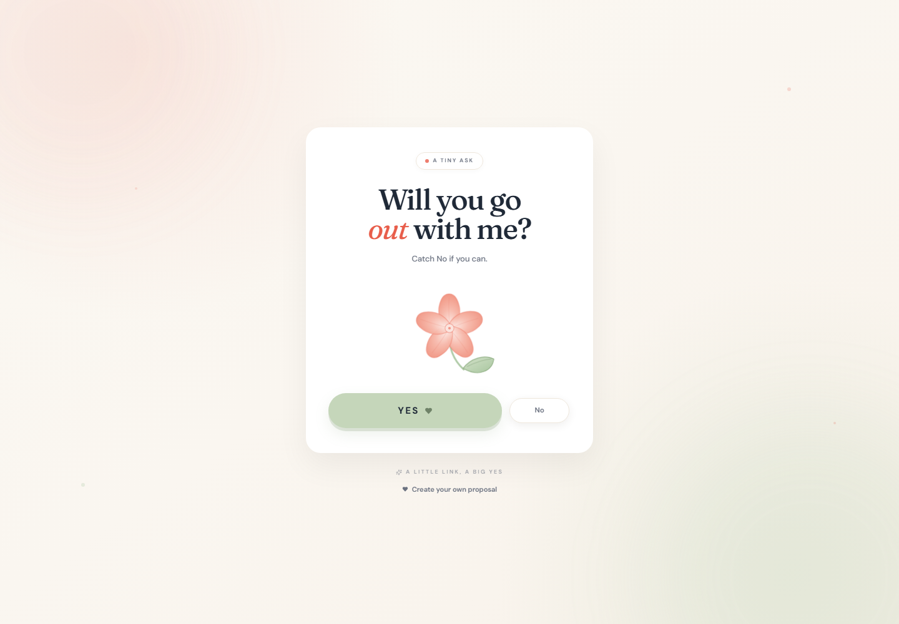

# A Tiny Ask 💌

An interactive, single-page romantic **date proposal and planner**. It starts with a playful question, a “No” button that keeps escaping, a confetti-filled confirmation, a date planner, and a personalized letter with a shareable response link.

Everything runs in the browser. There is no backend, database, account system, or tracking.



## What it does

1. **The ask** — a warm, editorial proposal card. Try to catch the “No” button: it dodges your pointer, changes its wording, and eventually gives up after eight escapes, leaving only a full-width **YES**.
2. **The confirmation** — heart-and-petal confetti, a blooming flower, and a “Yay — it's a date” moment.
3. **The plan** — pick a day, a time, and one of six activities: coffee, a movie, dinner, a walk in the park, drinks, or a surprise.
4. **The letter** — a personalized note with the date, time, and activity laid out in a sealed-letter card.
5. **The response** — send the generated link back to the sender. They see a dedicated “They said yes” page with the exact plan and can save it to their calendar.

You can also create a custom proposal link from the footer and choose the sender and recipient names. Names default to the generic placeholders **Me** and **you**, producing “Dear you,” and “— Me 💌” in the letter.

## Features

- Responsive layout for mobile, tablet, and desktop
- Custom coral five-petal SVG flower with a sage leaf
- Custom canvas confetti using petal and heart shapes
- Continuous falling-petal background on later screens
- Date/time inputs displayed as `YYYY-MM-DD` and `HH:MM`
- Disabled submit button until the plan is complete
- URL-encoded proposal and response links
- Sender-side response view with an `.ics` calendar download
- Native Web Share, Clipboard API, legacy copy fallbacks, and a visible selectable link when both are blocked
- Touch, mouse, and pointer dodging for the “No” button at small screen sizes
- Keyboard focus states, safe-area spacing, and reduced-motion support
- Bundled Fraunces and DM Sans fonts, so the app does not depend on Google Fonts at runtime

## Tech stack

| Tool | Purpose |
| --- | --- |
| React 18 + TypeScript | UI and state |
| Vite 5 | Development server and production build |
| Tailwind CSS 3 | Styling and responsive layout |
| Framer Motion | Screen transitions and micro-interactions |
| canvas-confetti | Custom petal and heart confetti |
| Lucide React | Interface icons |
| Fontsource | Self-hosted variable fonts |

## Run it locally

### Prerequisites

- [Node.js](https://nodejs.org/) 18 or newer
- npm (included with Node.js)
- Git

### Steps

1. Clone the repository:

   ```bash
   git clone https://github.com/<your-username>/date-maker.git
   cd date-maker
   ```

2. Install dependencies:

   ```bash
   npm install
   ```

3. Start the development server:

   ```bash
   npm run dev
   ```

4. Open the local URL printed in the terminal, usually:

   ```text
   http://localhost:5173/
   ```

### Production build

```bash
npm run build
npm run preview
```

The build output is written to `dist/`. `npm run preview` serves that production build locally.

## How to use the app

### Send a proposal

1. Open the app and tap **YES**.
2. Choose a day, time, and activity.
3. Select **Seal it with a letter 💌**.
4. On the letter screen, choose **Share the good news 💌** to use your device's share sheet or clipboard, or **Copy response link**.
5. If sharing and copying are both blocked, select **Show link** and copy the visible link manually.
6. Send the link to the person who proposed.

When they open it, they see the confirmed details and can add the date to their calendar.

### Create a custom proposal link

Select **Create your own proposal** in the footer. Enter the two names and generate a link. If either field is left blank, the app uses the generic defaults **Me** and **you**. If the share sheet or clipboard is blocked, the generated link stays visible in a selectable box.

The proposal link looks like this:

```text
https://your-site.example/?from=Me&to=you
```

A response link carries the full plan:

```text
https://your-site.example/?reply=1&from=you&to=Me&date=2026-12-24&time=19%3A30&plan=movie
```

### Link parameters

| Parameter | Meaning |
| --- | --- |
| `from` | Sender name on a proposal link; responder name on a response link |
| `to` | Recipient name on a proposal link; original sender on a response link |
| `reply=1` | Opens the sender-facing response view |
| `date` | Date in `YYYY-MM-DD` format |
| `time` | 24-hour time in `HH:MM` format |
| `plan` | One of `coffee`, `movie`, `dinner`, `walk`, `drinks`, or `surprise` |

Names are normalized, trimmed, stripped of control characters, and limited to 40 Unicode characters. Invalid dates, times, or plan IDs do not produce a response view.

## Privacy and security

- **No backend and no accounts.** The app does not send names, dates, or plans to a server.
- **No analytics or tracking scripts.**
- **No API keys or secrets.** All text files in this repository are free of credentials and personal contact details.
- **No third-party runtime requests for fonts or assets.** Fonts are bundled by Vite.
- **Everything is encoded in the URL.** A proposal link contains the two names. A response link also contains the date, time, and selected activity.
- **Treat share links as private.** Anyone with a response link can read the details encoded in it, so only send it to the intended person.
- **Calendar files are generated locally** in the browser when the sender selects **Add to calendar**.

Nothing is stored in `localStorage`, cookies, or a database.

## Deploy it yourself

This is a static Vite app, so it works on any static host. No environment variables, server functions, or database setup are required.

### Vercel

1. Push the project to GitHub.
2. In Vercel, choose **Add New → Project** and import the repository.
3. Use the **Vite** framework preset.
4. Set the build command to `npm run build`.
5. Set the output directory to `dist`.
6. Deploy.

### Netlify

1. Push the project to GitHub.
2. In Netlify, choose **Add new site → Import an existing project**.
3. Set the build command to `npm run build`.
4. Set the publish directory to `dist`.
5. Deploy.

### Any static host

Run:

```bash
npm run build
```

Then upload the contents of `dist/` to your host. The app only uses query-string links, so no server-side rewrite rules are needed.

> **GitHub Pages note:** if the site will live at `https://<username>.github.io/date-maker/`, set `base: '/date-maker/'` in `vite.config.ts` before building so asset URLs resolve correctly.

## Project structure

```text
date-maker/
├─ docs/
│  └─ preview.png
├─ src/
│  ├─ components/     # Card, badge, flower, petals, toast, share modal, link box
│  ├─ lib/            # URL sharing, date formatting, plans, confetti, clipboard
│  ├─ steps/          # Ask, confirmation, planner, letter, reply screens
│  ├─ App.tsx         # Flow state and page shell
│  ├─ index.css       # Design tokens and shared component styles
│  └─ main.tsx        # React entry point
├─ index.html
├─ tailwind.config.js
├─ vite.config.ts
└─ package.json
```

## Useful scripts

| Command | Description |
| --- | --- |
| `npm run dev` | Start the Vite development server |
| `npm run build` | Type-check and create a production build in `dist/` |
| `npm run preview` | Preview the production build locally |

## Customize it

- **Colors and shadows:** edit `tailwind.config.js` and the design tokens in `src/index.css`.
- **Activity choices:** edit `src/lib/plans.ts`.
- **Copy and letter wording:** edit the relevant screen in `src/steps/`.
- **Default names:** the `Me` and `you` fallbacks live in `src/lib/share.ts`.

## Browser support

The app is designed for current iOS Safari, Android browsers, desktop Chrome, Edge, Firefox, and Safari, plus common in-app browsers. Clipboard access and native sharing depend on browser support and permissions; when either is blocked, the app falls back to legacy copy methods and finally a visible, selectable link box.

---

Made for a tiny question with a very big answer.
